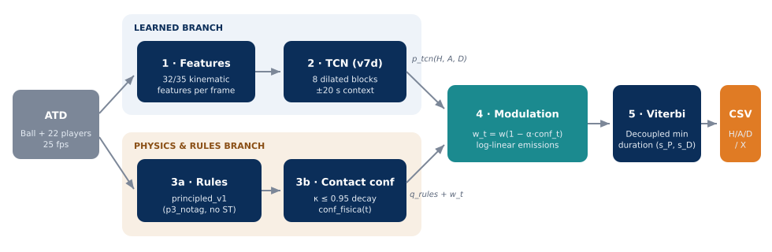
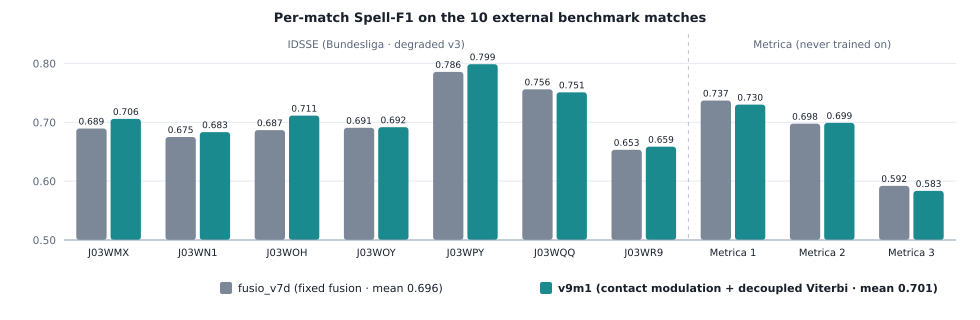
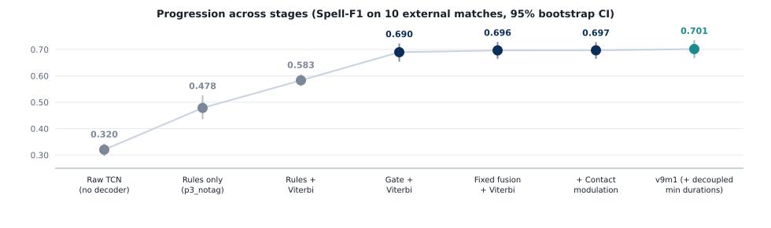
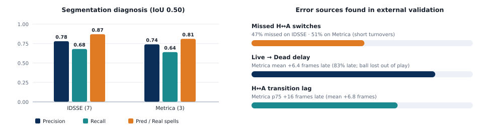

# Ball possession from tracking data (`v9m1`)

**Team El Chato** · match BAR–ATH · input: ATD tracking only

| **0.701** Spell-F1 [0.667, 0.735]<br>10 external matches (Macro-F1: 0.893) | **+0.0047** vs `markius_v9`<br>95% CI [+0.0004, +0.0105] (6/10 matches) | **ATD only**<br>No video, no Smart Tagging, no labels | **Byte-exact**<br>SHA-256 `b9cab719...25ed` |
|---|---|---|---|

## 1. Approach



| Step | What it does | How | Why |
|---|---|---|---|
| **1 · Features** | Describes each frame with 32 kinematic values | Ball coordinates, visibility, smoothed speed/acceleration, time since last seen, boundary distances; for each team, distance and relative speed of the two closest players, centroid, spread, visible count; oriented by attacking direction | A compact, team-symmetric geometric view around the ball |
| **2 · TCN (`v7d`)** | Per-frame `H / A / D` probabilities | Non-causal temporal convolutional network: 8 dilated residual blocks (dilation 1 → 128, receptive field ±510 frames ≈ ±20 s); trained on `v3`-degraded external matches with 3× loss weight within ±0.5 s of transitions | Possession depends on seconds of past and future context |
| **3a · Rules (`p3_notag`)** | Deterministic `H / A / D` label | `principled_v1` (`p3_notag`, without Smart Tagging): nearest reachable player becomes candidate; switches on controlled touch; dead ball when out of play or players visibly stop; outputs `control_clar` | Transparent and strong when a player clearly controls the ball |
| **3b · Contact confidence** | Invariant physical contact score `conf_fisica` | $\text{conf}_t = \max_{T \in \{H,A\}} \exp(-0.20\,v_{\text{rel},T}) \cdot \mathbf{1}[\kappa_T \le 0.95]$ using dimensionless reach ratio $\kappa \le 0.95$ | Measures how physically certain ball control is at frame $t$ |
| **4 · Dynamic modulation** | Modulates TCN vs rules weight per frame | $w_t = w\,(1 - \text{factor}\cdot\text{conf}_t)$ with `w=1.0`, `factor=0.35`, `lam=0.25`; log-linear emission $e_t(c) = \lambda [w_t \log(p_t(c)/\pi_c) + (1 - w_t)\log q_t(c)]$ | Relies on the TCN in ambiguous play and shifts weight to rules under clear physical contact |
| **5 · Decoupled Viterbi** | Smooth possession spells per half | Hidden Markov model with mandatory state chains `m_c = round(s_c * p5_c)` using decoupled multipliers `s_dur = [1.0, 1.0, 0.25]` (`s_P=1.0` live `H/A`, `s_D=0.25` dead `D`) | Prevents spell over-fragmentation while keeping brief dead-ball stoppages |

**How the pieces fit together.** Two independent branches process the ATD tracking: a *learned temporal branch* (features → TCN `v7d`) and a *deterministic physical branch* (`p3_notag` rules + `conf_fisica`). They meet solely in the log-linear emissions of the Viterbi decoder, where clear physical contact dynamically lowers the TCN weight $w_t$ from `1.0` down toward `0.65`, and decoupled minimum durations preserve short dead-ball intervals without fracturing live possessions. Frames outside the two halves are labelled `X`.

## 2. Possession rules & parameters

| Situation | Label |
|---|---|
| Ball out of bounds, stoppage, or players visibly stopped, until first restart touch | **Dead ball (`D`)** |
| Team B executes a controlled action (pass, carry, shot, keeper catch) | Possession switches to B **from first touch** |
| Loose ball, challenge, deflection, or block without control | Possession **stays** with previous team |
| Spell shorter than decoupled minimum (`s_P=1.0` live, `s_D=0.25` dead) | Suppressed by Viterbi |
| Ball not tracked | **Not** `D` by itself (TCN + player kinematics bridge gaps) |

- **No Smart Tagging (`p3_notag`)**: Smart Tagging is never read at inference or tuning.
- **Inherited physical constants**: stoppages use player mean-speed thresholds `1.40 / 1.90 m/s` (from `principled_v1`), contact reach ratio $\kappa \le 0.95$, and relative-speed decay $0.20\text{ (m/s)}^{-1}$ (from `markius_v5`).
- **Rule screening**: three candidate rule modifications (`p3_notag_contest`, `p3_notag_control`, `p3_notag_restart`) were pre-registered and screened on the 10-match external benchmark; all three slightly lowered `spell-F1` (`-0.0002` to `-0.0009`) and were rejected.

## 3. Training data & external benchmark

| Dataset | Matches | Role | Labelled by | Source · licence |
|---|---|---|---|---|
| **IDSSE** (Bassek et al., *Sci. Data* 12:195, 2025) | 7 · Bundesliga 2022/23 · ~11 h | TCN training + nested decoder selection | DFL / Sportec official events & ball status | Figshare · CC-BY 4.0 |
| **SkillCorner** Open Data | 20 · A-League 2024/25 | TCN training + HMM prior statistics | SkillCorner automatic system | GitHub · MIT |
| **Metrica** Sports sample data | 3 · anonymised | **Hold-out test only** | Metrica events | GitHub · open sample |

All external tracking is converted to 25 fps, metres, centred pitch, and degraded (`v3`) using **label-free aggregate statistics** of the competition tracking (ball dropout around kicks, slow wander, player drop-outs, and team swaps). Decoder parameters (`w`, `factor`, `lam`, `s_P`, `s_D`) were selected via nested cross-validation over the 7 IDSSE folds (`results/v9m1/decoder_parametres_per_plec_deg3_v7d_v9m1.json`), while the 3 Metrica matches were never seen by either the TCN or the decoder grid search.

## 4. Results & progression





| Model | Spell-F1 (10) [95% CI] | Macro-F1 (10) | IDSSE (7) | Metrica (3) | BAR–ATH sanity (spells / mean dur / % D) |
|---|---|---|---|---|---|
| `tcn_v7d` (raw argmax) | 0.320 [0.296, 0.343] | 0.891 | 0.321 / 0.907 | 0.319 / 0.853 | 674 / 5.57 s / 40.89% |
| `janv1_notag` (`p3_notag` rules) | 0.478 [0.436, 0.526] | 0.761 | 0.434 / 0.732 | 0.582 / 0.829 | 345 / 9.98 s / 45.84% |
| `janv1_vit` (rules + Viterbi) | 0.583 [0.562, 0.606] | 0.840 | 0.577 / 0.845 | 0.596 / 0.828 | 305 / 11.25 s / 46.02% |
| `porta_v7d` (gate + Viterbi) | 0.690 [0.654, 0.723] | 0.891 | 0.701 / 0.906 | 0.662 / 0.856 | 196 / 17.76 s / 45.23% |
| `fusio_v7d` (fixed fusion) | 0.696 [0.664, 0.728] | 0.891 | 0.705 / 0.906 | 0.676 / 0.856 | 208 / 17.84 s / 41.59% |
| `markius_v9` (+ contact mod.) | 0.697 [0.664, 0.727] | 0.892 | 0.708 / 0.908 | 0.670 / 0.856 | 208 / 18.31 s / 40.06% |
| **`v9m1` (`markius_v9_m1`)** | **0.701 [0.667, 0.735]** | **0.893** | **0.714 / 0.909** | **0.671 / 0.856** | **211 / 18.06 s / 40.03%** |

Robustness check with alternative duration-based labelling (`label_dur`): `0.693 [0.658, 0.728]` vs `0.690` (`markius_v9`) and `0.692` (`fusio_v7d`).

## 5. Assets: used, dropped & diagnosis



| Used | Not used | Tried and rejected (external benchmark) |
|---|---|---|
| ATD tracking only (`predict.py`) | Video, homographies | `v9_r` neutral TCN in ball gaps (`0.688` vs `0.697`) |
| `tcn_v7d` + `principled_v1` (`p3_notag`) | Smart Tagging events | Extended grid `v9m1x` (`0.701` on `label_acc`, drops to `0.687` on `label_dur`) |
| `conf_fisica` + decoupled Viterbi (`s_P=1.0, s_D=0.25`) | Broadcast tracking | Symmetric `H/A` HMM stats (`-0.0003`, 3/10 matches) |
| IDSSE, SkillCorner, Metrica (external only) | Any BAR–ATH labels | Rule variants `contest` (`-0.0006`), `control` (`-0.0009`), `restart` (`-0.0002`) |

**Known limitations (verified by pre-registered diagnosis):**
1. **Missed short turnovers**: predicted/real spell count is `0.87` on IDSSE and `0.81` on Metrica (`IoU 0.50` precision/recall: `0.78/0.68` on IDSSE, `0.74/0.64` on Metrica); `47%` (IDSSE) and `51%` (Metrica) of `H ↔ A` switches are missed.
2. **Real-tracker dead-ball tail**: on Metrica, live→dead transitions arrive `+6.4` frames late on average (`83%` late; `H ↔ A` p75 `+16` frames) when the real tracker drops the ball leaving play and stoppages are inferred from player deceleration.

## 6. Reproduction

```bash
python3.12 -m venv .venv
.venv/bin/pip install -r requirements.lock --extra-index-url https://download.pytorch.org/whl/cpu
.venv/bin/python predict.py --data <data_folder> --out submission.csv
```

- Runs on CPU (2 threads, deterministic algorithms, fixed seeds) in ~45 seconds.
- Expected output SHA-256: `b9cab7198add0f670849b0c34e92702d50c9a5703b8231a36a96a1cc287825ed`.
- Format validation: `python evaluation/validate_submission.py submission.csv`.
